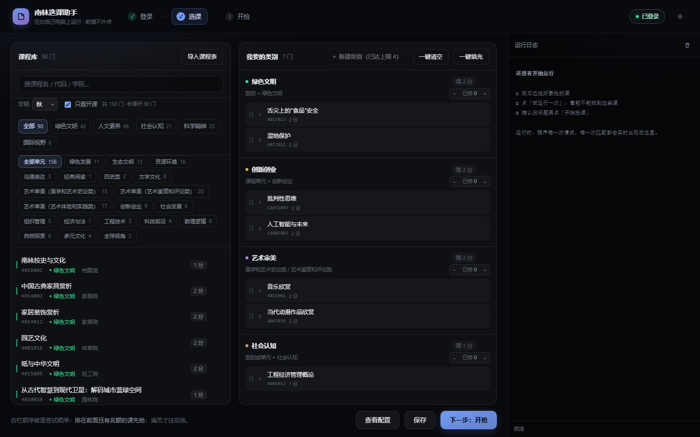
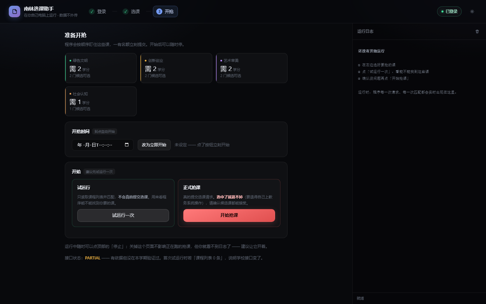
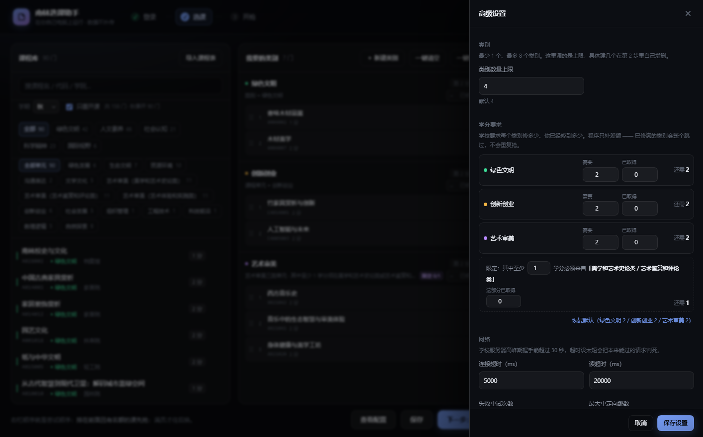
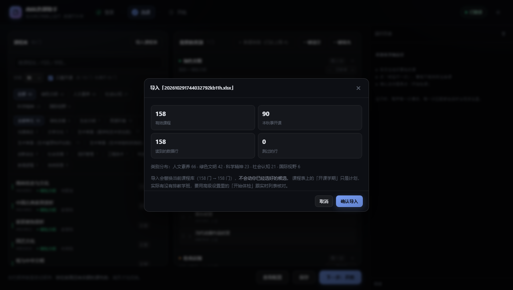

<div align="center">

# 南林选课助手 · NFU-QK

**南京林业大学教务系统自动选课工具** —— 通识选修课（公选课）

[](https://github.com/fuluffy/NFU-QK/actions/workflows/test.yml)


零运行时依赖 · 纯本地运行 · 不需要抓包和改代码就能配置

</div>

---

## ⚠️ 使用前必读

- 本工具**仅供个人学习研究、为自己选课**使用。**禁止用于收费代抢、多账号抢课或任何牟利行为**（许可证里也是这么写的，商业使用不被授权）。
- 请先了解并遵守学校关于选课的规定。使用本工具产生的一切后果由使用者本人承担。
- 这是**非官方**的个人项目，与学校无关；教务系统改版可能导致它失效。
- 程序**没有自动退课功能**，选错的课请自己登录教务系统退。
- 不保证抢课成功 —— 高峰期服务器过载、课程满员都是常态，工具只能提高成功率，不能变出名额。

---

## ✨ 它能做什么

- **一键登录**：自动完成统一身份认证（含 2026-11 苏迪改版后的 RSA 密码加密），不需要浏览器
- **按类别凑学分**：把候选课按类别分桶（如「绿色文明 2 学分」「艺术审美 2 学分，其中 1 学分须来自指定子类」），程序自动补差额，修满的类别自动跳过
- **高峰期生存设计**：单并发低频、指数退避、提交绝不盲目重试（超时先查已选列表确认）、服务器时钟对齐 —— 专为 12:30 开抢那种「全校一起点」的时刻设计
- **看得见的运行过程**：每一轮请求、命中哪门课、满员还是成功，全部实时显示在日志里
- **只读体检**：开抢前逐门核对候选 —— 哪门能抢、哪门满员、哪门**本学期根本没排课**（课表上写着「春、秋」也可能不排班）
- **课程表导入**：教务处发的 `.xlsx` / `.csv` 课表直接拖进来就能用，不用手工抄课程代码

## 📸 界面预览

双击 `启动选课助手.cmd` 后，浏览器会自动打开这个页面，按 **① 登录 → ② 选课 → ③ 开抢** 三步走：



左边是课程库（可搜索、按类别/单元筛选），右边是「我要的类别」—— 点课程卡片就加入对应类别，学分修满自动达标：

| 开抢页：先试运行，再正式抢 | 高级设置：各类别所需/已取得学分 |
|---|---|
|  |  |

高级设置里最下面那条**限定条件不是摆设**：程序会只到「美学和艺术史论类 / 艺术鉴赏和评论类」的候选里去凑那 1 学分，不会拿好抢的「艺术体验」课凑总数（那样学校审核不认）。

教务处的课表也可以直接导入，先预览统计再确认落盘：



---

## 🚀 快速开始

### 第 0 步：准备

1. 安装 [Node.js](https://nodejs.org/)（选 **LTS** 版本，一路下一步，只需装一次；要求 Node ≥ 20）
2. 获取代码，两种方式任选：
   - **不会用 Git**：点仓库右上角绿色 `Code` 按钮 → `Download ZIP`，解压到任意目录
   - **会用 Git**：`git clone` 到本地

### 第 1 步：启动

双击项目根目录的 **`启动选课助手.cmd`**。

> 如果 Windows 弹出蓝色提示「已保护你的电脑」，点 **更多信息 → 仍要运行**（脚本没有任何签名，这是正常现象）。它只是在本地起了一个只监听 `127.0.0.1` 的服务，然后自动打开浏览器 —— 关掉黑色命令行窗口就是停止服务。

### 第 2 步：登录

在页面第 1 步输入**学号和密码**，点「登录」。

- 密码只在当次登录用一次，**不写入任何文件**；学号记在浏览器本地，下次不用重填
- 见过「登录成功但马上掉线」？那是个已修复的老 bug —— 如果遇到，更新代码后重新登录即可
- **不要反复点登录**：短时间连续登录多次会被学校统一认证限流（表现为登录页打不开），等几分钟自己恢复

### 第 3 步：选课

在第 2 步把想抢的课点进右边对应类别（点一下加入、再点一下移出，可拖动排序）：

- 三个默认类别（绿色文明 / 创新创业 / 艺术审美）的学分要求可以在**右上角齿轮 → 学分要求**里改，已修过的学分填进「已取得」，程序只补差额
- 不止这三类？「＋ 新建类别」自己加，点一门不属于任何类别的课也会自动建类别
- 右上角「导入课程表」可以导入教务处的 `.xlsx`/`.csv`，不用手工找课程代码

### 第 4 步：开抢

1. 先点**「试运行一次」**：只查询和匹配、不提交，确认它真的能找到你的课
2. 没问题再点**「开始抢课」**，或设一个开抢时间让它到点自动开始
3. 跑着的时候可以关页面（程序继续跑），回来还能看日志

抢课中途出现「满员」是正常的 —— 程序会持续蹲守，有人退课就立刻选上。

---

## ⌨️ 命令行（可选）

不想用界面也可以直接用命令行；Mac / Linux 用户把 `.cmd` 换成对应命令即可：

```bash
node src/cli.js ui                  # 图形界面（等同于双击 .cmd）
node src/cli.js doctor              # 环境自检
node src/cli.js login               # 登录（保存会话）
node src/cli.js rounds              # 发现当期选课轮次
node src/cli.js check --config config.json   # 只读体检：能抢/满员/没排课（config.json 由界面「保存配置」生成）
node src/cli.js run   --config config.json   # 干跑（查询+匹配，不提交）
node src/cli.js run   --live        # 实跑（真的会选课！先干跑确认过再用）
node src/cli.js catalog --import 课表.xlsx          # 导入课程表
node src/cli.js simulate --scenario open-later --live   # 本地演练，不碰学校服务器
npm test                            # 215 个测试
```

<details>
<summary><strong>本地演练（不接触学校服务器）</strong></summary>

内置了一个复刻真实系统各种坑的 Mock 选课服务器，可以在离线状态下走完整个流程：

```bash
node src/cli.js simulate --scenario normal        --live   # 正常抢到
node src/cli.js simulate --scenario open-later    --live   # 满员蹲守 → 有人退课 → 抢到
node src/cli.js simulate --scenario lost-response --live   # 响应被切断 → 查已选列表确认，不重复提交
node src/cli.js simulate --scenario flaky         --live   # 随机 5xx / 连接重置
```

</details>

---

## ❓ 常见问题

<details>
<summary><strong>登录失败，提示证书过期（CERT_HAS_EXPIRED）？</strong></summary>

学校教务系统的证书已过期，跟你的账号无关。本项目默认关闭了 TLS 校验（`net.rejectUnauthorized: false`），正常不需要你做任何事。代价是理论上存在中间人风险 —— 不要在公共 Wi-Fi 下使用。
</details>

<details>
<summary><strong>一直「列表 0 条」？</strong></summary>

两种可能，必须分清：

- 选课**批次还没开放**（比如提前几小时）—— 这是正常的，等批次出现
- 学校**接口改版**了 —— 跑一次只读体检（`node src/cli.js check` 或界面里的「开始体检」），如果体检也拿不到列表，说明接口变了，需要更新配置

程序遇到「返回了 0 条但不是合法 JSON」会直接报错而不是当作没课，就是为了不让人白等。
</details>

<details>
<summary><strong>显示「满员」怎么办？</strong></summary>

蹲。程序会持续轮询，有人退课的瞬间就会提交。类别别的课还有余量时，会先试下一门候选，不会死磕一门。
</details>

<details>
<summary><strong>显示「本学期没排课」？</strong></summary>

课程表上写着「春、秋」只是**计划**，当学期不一定真的排了教学班（实测遇到过）。这种情况等也等不来，趁早换课。体检会逐门告诉你这个状态。
</details>

<details>
<summary><strong>抢到了想退课？</strong></summary>

程序没有退课功能（刻意不做的），登录教务系统手工退。
</details>

<details>
<summary><strong>我的密码安全吗？</strong></summary>

密码只在登录那一瞬间使用，不写入任何文件；服务只监听 `127.0.0.1`，局域网里别人访问不到；所有数据都留在你自己的电脑上。代码是公开可审的，欢迎自己检查。
</details>

<details>
<summary><strong>Mac / Linux 能用吗？</strong></summary>

能。核心零运行时依赖，只要有 Node ≥ 20，`node src/cli.js ui` 即可；`.cmd` 只是 Windows 的一键启动脚本。
</details>

---

## 🧰 它是怎么工作的

核心是一个**配置驱动的流水线引擎**：程序本身不认识「正方教务系统」，只按 JSON 配置里声明的步骤走
（列表 → 提交 → 确认）。学校改版时改的是配置，不是代码。

- 端点、字段名、参数格式全部外化在 profile 里，代码不写死任何一门课
- 提交凭证是**当次现取**的，不缓存、不复用、不写死
- 零运行时依赖，只用 Node 内置模块；215 个自动化测试覆盖了「响应被切断后不重复提交」这类真会让人白等一晚上的场景

想接手维护或深入了解架构取舍：[方案设计.md](方案设计.md)。

---

## 📄 许可证

[PolyForm Noncommercial 1.0.0](LICENSE) —— 简单说：

- ✅ 个人使用、学习、修改、分享给同学，都可以
- ❌ **商业用途不被授权**，包括但不限于：收费代抢、打包出售、集成进商业服务

这和上面的免责声明是一体的：这个工具只该帮学生自己选课。如果你希望换成一个更宽松的许可证（如 MIT），把 `LICENSE` 文件替换掉即可。

---

<div align="center">

选课本质上是在和全校同学抢有限的名额 —— 祝你都能选到想要的课 🙂

</div>
